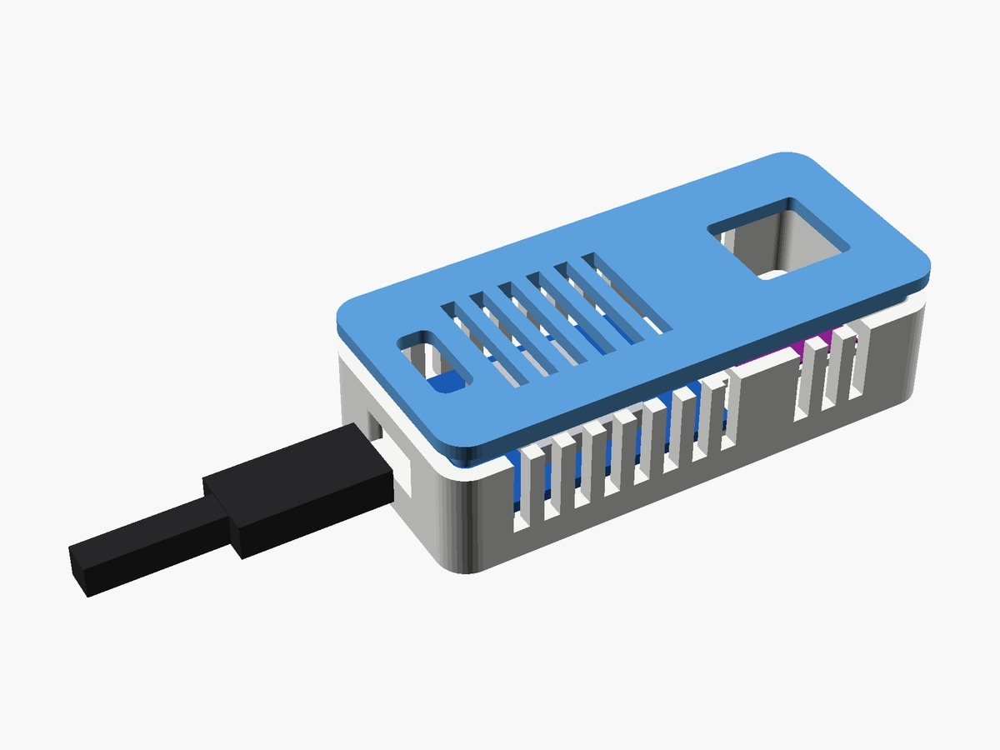

# Temperature, humidity and pressure sensor for Home Assistant

> 📖 **Full article with wiring diagram, photos and step-by-step explanations (in Italian):**  
> **[Temperature, humidity and pressure sensor for Home Assistant – www.emgi.it](https://www.emgi.it/2026/04/03/sensore-temperature-umidita-e-pressione-per-home-assistant/)**
>
> More electronics, Arduino, ESP32, Home Assistant and 3D printing projects at **[www.emgi.it](https://www.emgi.it)**

This project integrates with Home Assistant. If you have not installed it yet, start from the guide [How to install Home Assistant on Raspberry Pi 4, 5 and Zero](https://www.emgi.it/2026/04/14/installare-home-assistant-su-raspberry-pi/) (in Italian).

Monitoring environmental conditions in real time is one of the simplest and most useful ways to make a home or a lab truly smart. In this project I built a Wi-Fi sensor compatible with Home Assistant that continuously and reliably measures **temperature**, **humidity** and **atmospheric pressure**.

## What it is for

A sensor like this is useful in many situations:

- monitoring the climate of a room
- keeping an eye on the lab environment
- checking conditions in a cellar, garage or attic
- automatically switching fans, dehumidifiers or sending notifications
- collecting data for statistics and long-term analysis

## Parts used

You can use a compact Wi-Fi board such as an ESP32 or ESP8266, together with a suitable environmental sensor.

Typical parts:

- **ESP8266** board **WEMOS D1 Mini V4.0.0**
- **BMP280 + AHT20** environmental sensor (single module) or another equivalent combination for temperature, humidity and pressure
- USB power supply
- optional 3D-printed case
- Dupont wires and a mounting board

## Wiring

Board: **Wemos D1 mini** (ESP8266) with a combined **AHT20 + BMP280** module (I2C). Pins checked against the sketch (`I2C_SDA 4`, `I2C_SCL 5`, `Wire.begin(I2C_SDA, I2C_SCL)`).

| Wemos D1 mini | AHT20 + BMP280 module |
|---|---|
| **3V3** | VCC (VIN) |
| **GND** | GND |
| **D2 / GPIO4** | SDA |
| **D1 / GPIO5** | SCL |

- Power the module from **3.3 V**.
- The case ([`case_3d`](case_3d)) keeps the sensor separate from the D1 mini: the board's heat would skew the temperature reading.
- The Wemos D1 mini is powered from its 5 V USB port; the module takes 3.3 V from the **3V3** pin, nothing else is needed.
- I2C modules already have pull-up resistors on board: no external resistors are needed.

## Repository contents

| Path | Description |
|---|---|
| `Climate_Sensor_ESP8266/Climate_Sensor_ESP8266.ino` | Arduino sketch |
| `case_3d/wemos_d1mini_aht20_bmp280_case.scad` | Parametric OpenSCAD source |
| `case_3d/wemos_d1mini_aht20_bmp280_case.stl` | 3D model to print |
| `images/` | Photos and images |

## How to use it

1. Open [`Climate_Sensor_ESP8266.ino`](Climate_Sensor_ESP8266) in the Arduino IDE.
2. Set your Wi-Fi SSID, password, IP address and gateway (lines 7-11) and the sensor name.
3. Upload it, then open `http://<sensor-IP>/` for the web dashboard; Home Assistant can read `http://<sensor-IP>/api/ha` (JSON with temperature, humidity and pressure).
4. The case is parametric: open [`case_3d/wemos_d1mini_aht20_bmp280_case.scad`](case_3d) with OpenSCAD.

Wiring diagram, details and troubleshooting: **[article on www.emgi.it](https://www.emgi.it/2026/04/03/sensore-temperature-umidita-e-pressione-per-home-assistant/)** (in Italian).

## License

- Code and configuration: [MIT](LICENSE)
- 3D models, diagrams and images: [CC BY-SA 4.0](https://creativecommons.org/licenses/by-sa/4.0/)

---

**Author:** Massimiliano Sandrin – **[eMGi.it](https://www.emgi.it)** · Questions and comments below the [article on the website](https://www.emgi.it/2026/04/03/sensore-temperature-umidita-e-pressione-per-home-assistant/).
